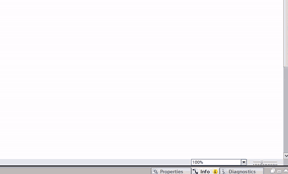
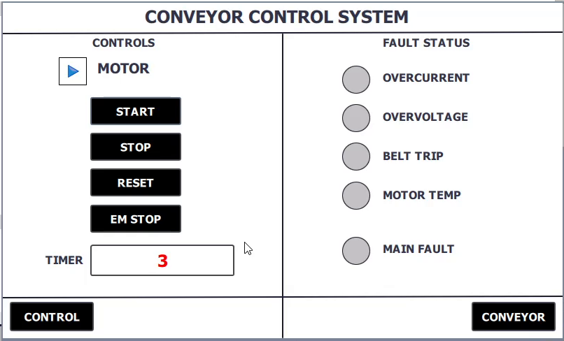
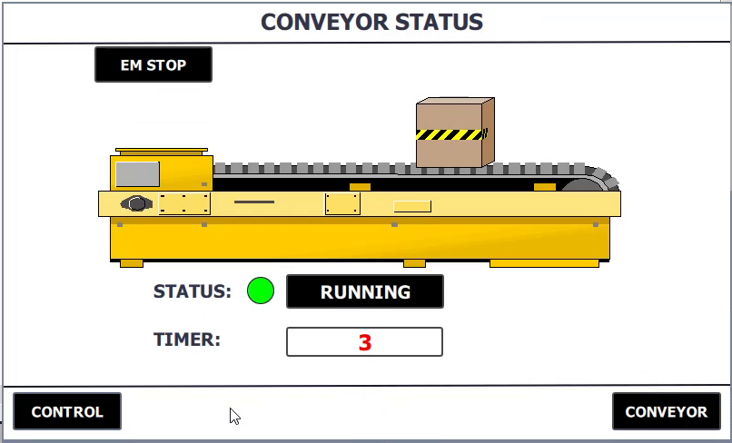
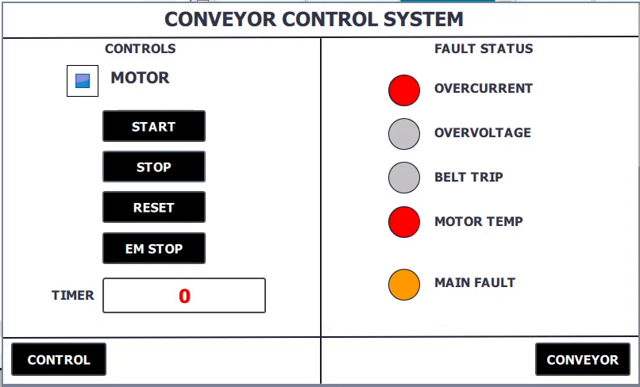
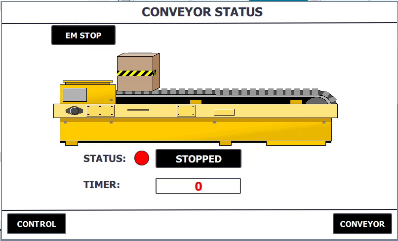
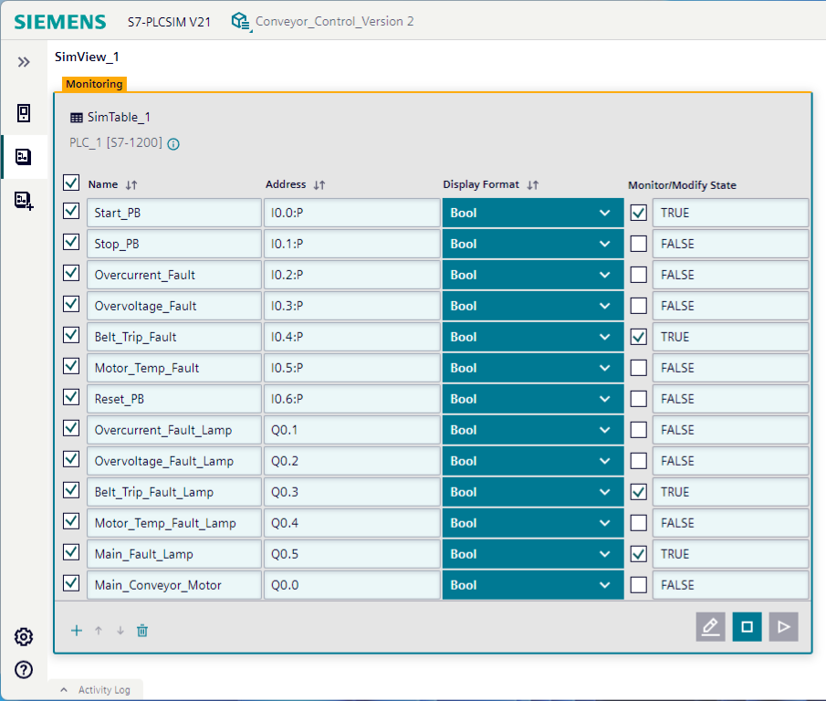
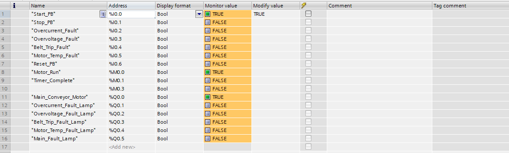

# Conveyor Motor Control System

Siemens **S7-1200** PLC program with a two-screen **KTP700 Basic PN** HMI for a single conveyor motor: start/stop, four fault inputs with a latched main fault, a run timer with auto-stop, and an animated status screen. Built in **TIA Portal V21** and tested virtually with **S7-PLCSIM V21** and the WinCC runtime simulation.



> Full simulation video: [`media/Conveyor_Control_HMI_Simulation.mp4`](media/Conveyor_Control_HMI_Simulation.mp4)
> Original LinkedIn post: <https://lnkd.in/p/gg7V4SgF>

## Documentation

The complete technical document (PLC tags, FB interface, every ladder network, HMI tag table, both screens with button events and animations, simulation captures) is here:

**[`docs/Conveyor_Control_System_Documentation.pdf`](docs/Conveyor_Control_System_Documentation.pdf)**

## Features

- Motor start / stop from physical push buttons **and** from the HMI
- Four monitored faults (overcurrent, overvoltage, belt trip, motor temperature), each with its own lamp
- Latched **Main Fault** (SET/RESET) that shuts the motor down and blocks restart until reset
- Motor run timer (TON, 25 s) with automatic stop on completion
- Timer shown on the HMI in seconds (TIME to DInt via MOVE + DIV)
- Emergency stop button on both HMI screens
- HMI animations: motor state graphic, fault lamps, status lamp/text, colour-changing conveyor image, moving box

## System at a glance

| Item | Detail |
| --- | --- |
| PLC | S7-1200, CPU 1212C DC/DC/DC, LAD |
| HMI | KTP700 Basic PN, 2 screens |
| Engineering | TIA Portal V21 |
| Simulation | S7-PLCSIM V21 + WinCC runtime simulation |
| Addressing | PLC `192.168.0.1`, HMI `192.168.0.2` |
| Architecture | `OB1` calls `FB_ConveyorMotor [FB1]` (instance `DB1`); `DB10 HMI_Data` holds timer values for the HMI |

### Program blocks

| Block | Purpose |
| --- | --- |
| `Main [OB1]` | Calls FB1 with the I/O tags, drives `%Q0.0` from `%M0.0` (Motor_Run) |
| `FB_ConveyorMotor [FB1]` | All control logic (9 networks) |
| `FB_ConveyorMotor_DB [DB1]` | FB1 instance data |
| `Run_Timer [DB2]` | TON instance |
| `HMI_Data [DB10]` | Timer value and seconds value for the HMI (optimised block access disabled) |

### PLC tags

| Tag | Address | Description |
| --- | --- | --- |
| Start_PB | `%I0.0` | Start push button |
| Stop_PB | `%I0.1` | Stop push button |
| Overcurrent_Fault | `%I0.2` | Fault input (TRUE = fault) |
| Overvoltage_Fault | `%I0.3` | Fault input (TRUE = fault) |
| Belt_Trip_Fault | `%I0.4` | Fault input (TRUE = fault) |
| Motor_Temp_Fault | `%I0.5` | Fault input (TRUE = fault) |
| Reset_PB | `%I0.6` | Fault reset |
| Main_Conveyor_Motor | `%Q0.0` | Motor run command (KM1) |
| Overcurrent / Overvoltage / Belt Trip / Motor Temp / Main Fault lamps | `%Q0.1` to `%Q0.5` | Fault lamps |
| Motor_Run | `%M0.0` | Motor running |
| HMI_Start_CMD / HMI_Stop_CMD / HMI_Reset_CMD | `%M0.3` / `%M0.4` / `%M0.5` | HMI command bits |

The full tag table, FB1 interface and DB10 layout are in the PDF (sections 3.2 to 3.4).

### FB1 ladder networks

| # | Network | # | Network |
| --- | --- | --- | --- |
| 1 | Motor start / stop control | 6 | Fault motor shutdown |
| 2 | Motor run timer (TON 25 s) | 7 | Auto stop on timer complete |
| 3 | Individual fault lamps | 8 | Timer complete reset |
| 4 | Main fault latch SET / RESET | 9 | Timer seconds conversion |
| 5 | Main fault indication | | |

Ladder images are in [`docs/images/ladder/`](docs/images/ladder/); the TIA Portal exports are in [`docs/tia-exports/`](docs/tia-exports/).

## HMI

| Screen | Content |
| --- | --- |
| `Conveyor_Control_System` | MOTOR indicator, START / STOP / RESET / EM STOP, timer, five fault lamps, navigation |
| `Conveyor_Status` | Animated conveyor image, moving box, RUNNING / STOPPED status, timer, EM STOP, navigation |

| Control screen | Status screen |
| --- | --- |
|  |  |
|  |  |

HMI buttons write dedicated `%M` command bits (physical `%I` inputs cannot be written from the panel) using SetBit / ResetBit events. Button events, animations and the HMI tag table are documented in PDF section 5.

## Simulation

| PLCSIM fault test | Watch table |
| --- | --- |
|  |  |

## Wiring

Field wiring diagram (24 V DC, push buttons, fault contacts, KM1 contactor, lamps, motor power circuit): [`docs/images/wiring_diagram.png`](docs/images/wiring_diagram.png).

## Repository layout

```
.
├── README.md
├── docs/
│   ├── Conveyor_Control_System_Documentation.pdf
│   ├── images/
│   │   ├── wiring_diagram.png
│   │   ├── ladder/          FB1 networks 1-9 and OB1 call
│   │   ├── hmi/             screen designs and runtime captures
│   │   └── simulation/      PLCSIM, online OB1 / FB1, watch table
│   └── tia-exports/         PDFs exported from TIA Portal (OB1, FB1, both HMI screens)
└── media/
    ├── Conveyor_Control_HMI_Simulation.mp4
    └── hmi_simulation_preview.gif
```

## Running the simulation

1. Open the project in TIA Portal V21 and compile the PLC and HMI.
2. Start S7-PLCSIM V21 and download the PLC program.
3. Start the HMI runtime simulation (PLC `192.168.0.1`, HMI `192.168.0.2`).
4. Use the HMI buttons, or set the inputs in a PLCSIM SimTable / TIA watch table (`%I0.0` to `%I0.6`) to start the motor and trigger faults.

## Notes

- The wiring diagram is illustrative. Its input/output order and NC drawing of the stop and fault contacts differ from the addresses and polarity used in the program (fault inputs are active-TRUE, `Stop_PB` uses an NC contact). Align them before wiring real hardware.
- `HMI_Start_CMD` is cleared by STOP, EM STOP, RESET and faults, but not by the timer auto-stop in Network 7. Check this behaviour if you start the motor from the HMI.
- The KTP700 Basic cannot animate images natively; the moving box is a separate graphic driven by a SimulateTag on the status screen.

## Author

Biraj
